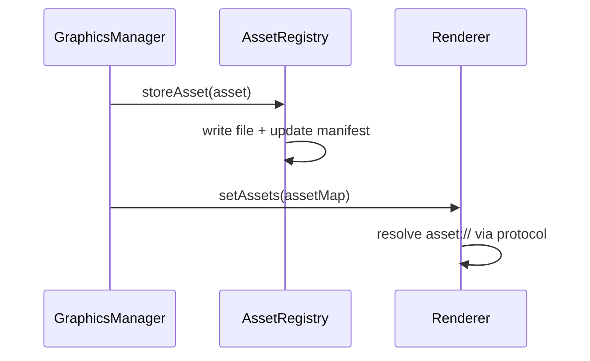

# Bridge Feature – Asset‑Management & Template‑Security

## Zweck
Diese Doku beschreibt, wie Assets gespeichert und geladen werden, sowie die Sicherheits‑Regeln für HTML/CSS‑Templates.

## Einstiegspunkte
- Asset Registry: `apps/bridge/src/services/graphics/asset-registry.ts`
- Template Sanitizer: `apps/bridge/src/services/graphics/template-sanitizer.ts`
- Template Bindings: `apps/bridge/src/services/graphics/template-bindings.ts`
- Renderer (Asset‑Protocol): `apps/bridge/src/services/graphics/renderer/electron-renderer-entry.ts`

## Asset‑Management
### Speicherung
- Assets werden im Bridge‑UserData‑Verzeichnis gespeichert.
- Struktur: `graphics-assets/` + `assets.json` Manifest.
- Größenlimits:
  - Pro Asset: 10 MB
  - Gesamt: 100 MB

### Asset‑IDs
- `assetId` muss `[a-zA-Z0-9_-]+` matchen.
- Assets werden per `asset://<assetId>` referenziert.

### Ablauf (Mermaid)

## Template‑Security
### HTML/CSS Regeln
Blockiert werden:
- `<script>` Tags
- Inline‑Event‑Handler (`on*=`)
- `<iframe>`, `<object>`, `<embed>`, `<link>`
- `<base>` Tags (würden jede relative Referenz umschreiben)
- `<meta http-equiv="refresh">` (Navigation weg vom Template; case‑insensitiv, auch ohne Anführungszeichen)
- `javascript:` URLs
- Externe URLs (`http://`, `https://`, `ws://`, `wss://`, `data:`, `file:`, `ftp:`, `blob:`)
- Protokoll‑relative URLs (`//host/...`) in URL‑tragenden Positionen: HTML‑Attribute `src`, `href`, `poster`, `srcset`, `action`, `formaction`, `xlink:href` sowie CSS `url(//…)` (auch mit Whitespace/Quotes). Prosa wie `a // b` oder `content: "//"` in CSS bleibt erlaubt.
- `@import` in CSS
- `</style>` Sequenzen (Style Breakout)

Bewusste Ausnahmen vom URL‑Scan (nur diese Formen):
- `xmlns="http://www.w3.org/..."` / `xmlns:*` / `xml:*` Attribute mit w3.org‑Host (Namespace‑Identifier für Inline‑SVG, werden nie geladen).
- `data:image/(png|jpeg|gif|webp|avif);base64,…` (eingebettete Raster‑Logos). `data:text/html` und `data:image/svg+xml` bleiben blockiert. Ab 256 KB eingebetteter Bilddaten gibt es eine Warnung.

Der Renderer lädt Templates als `data:text/html` (`electron-renderer-entry.ts`), wodurch protokoll‑relative URLs dort voraussichtlich nicht auflösen. Das ist eine Mitigation, keine Garantie: Der Sanitizer ist das einzige Gate und blockiert diese Vektoren unabhängig davon (Defense in Depth).

### Parität Bridge ↔ Webapp
Die Webapp hat einen eigenen Template‑Validator (`lib/graphics-template-security.ts` im `broadify`‑Repo). Stand dieser Änderung sind die Regelwerke nicht deckungsgleich; die Angleichung ist ein Webapp‑Follow‑up.

| Regel | Bridge | Webapp |
| --- | --- | --- |
| `<script>`, `on*=`, `<iframe>`, `<object>`, `<embed>`, `<link>` | blockiert | blockiert |
| `javascript:` URLs | blockiert | blockiert |
| Externe URLs `http(s):`, `data:`, `file:`, `ftp:` | blockiert | blockiert |
| `ws://` / `wss://` / `blob:` | blockiert | nicht blockiert |
| Protokoll‑relative URLs (`//host`) in Attributen / CSS `url()` | blockiert | nicht blockiert |
| `<base>` | blockiert | nicht blockiert |
| `<meta http-equiv="refresh">` | blockiert | nicht blockiert |
| `@import`, `</style>` | blockiert | blockiert |
| Ausnahme w3.org `xmlns` (Inline‑SVG) | erlaubt | nicht erlaubt (wird als externe URL abgelehnt) |
| Ausnahme `data:image/*;base64` Raster | erlaubt | nicht erlaubt (wird als externe URL abgelehnt) |

Folge: Ein Template kann in der Webapp durchgehen und an der Bridge scheitern (neue Blockregeln) oder umgekehrt (SVG/Raster‑Ausnahmen). Die Bridge‑Fehlermeldungen (`Template HTML contains <base> tags`, `Template HTML contains meta refresh`, `Template contains protocol-relative URLs`, `Template contains external URLs`) werden über den Prepare‑Pfad (`graphics-layer-prepare-service.ts`) als Validation Error zurückgegeben.

### Sanitizing
- CSS‑Block‑Kommentare werden vor Validierung entfernt.
- Template wird vor Rendern validiert.

### Bindings
- Text‑Bindings und CSS‑Variablen werden aus Schema/Defaults abgeleitet.
- `animation` wird in CSS‑Klassen gemappt (siehe `animation-css.ts`).

## Fehlerbilder
- Asset nicht vorhanden → Validation Error (`Missing asset reference`)
- Asset zu groß → Error (10MB/100MB Limits)
- Template enthält unsichere Tags/URLs → Validation Error

## Relevante Dateien
- `apps/bridge/src/services/graphics/asset-registry.ts`
- `apps/bridge/src/services/graphics/template-sanitizer.ts`
- `apps/bridge/src/services/graphics/template-bindings.ts`
- `apps/bridge/src/services/graphics/renderer/electron-renderer-entry.ts`
