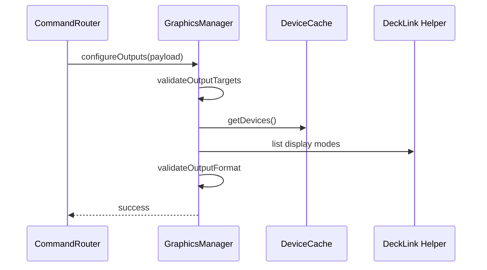

# Bridge Feature – Output‑Konfiguration & Pixel‑Policy

## Zweck
Diese Doku beschreibt, wie Outputs konfiguriert, validiert und für Hardware‑Ausgabe vorbereitet werden (Ports, Formate, Pixel‑Formate, Range/Colorspace).

## Einstiegspunkte
- Command: `graphics_configure_outputs`
- Validierung/Orchestrierung: `apps/bridge/src/services/graphics/graphics-manager.ts`
- Schemas: `apps/bridge/src/services/graphics/graphics-schemas.ts`
- Target-/Format-Validierung: `apps/bridge/src/services/graphics/graphics-output-validation-service.ts`
- Output‑Policy: `apps/bridge/src/services/graphics/output-format-policy.ts`
- Port‑Parsing: `apps/bridge/src/services/graphics/output-adapters/decklink-port.ts`
- Device‑Detection: `apps/bridge/src/services/device-cache.ts`, `apps/bridge/src/modules/decklink/*`

## Payload (Beispiel)
```json
{
  "version": 1,
  "outputKey": "key_fill_sdi",
  "targets": {
    "output1Id": "<device>-sdi-a",
    "output2Id": "<device>-sdi-b"
  },
  "format": { "width": 1920, "height": 1080, "fps": 50, "displayModeId": 13 },
  "range": "legal",
  "colorspace": "auto"
}
```

## Output‑Key Regeln
- `key_fill_sdi`
  - Output1/Output2 erforderlich
  - Beide SDI, gleicher Device
  - Output1 = Fill, Output2 = Key
- `video_sdi`
  - Output1 erforderlich
  - SDI‑Port, **kein** Key‑Port
- `video_hdmi`
  - Output1 erforderlich
  - HDMI/DisplayPort/Thunderbolt‑Port
  - Kein DeckLink-Fallback: ist der Ziel-Port nicht im Device-Cache (Display
    abgezogen), wirft `selectOutputAdapter()` `output_device_not_found`
    („Display output `<id>` is not connected"); die persistierte Config bleibt
    erhalten, der Output-Supervisor wartet auf den Device-Change. Nur ein im
    Cache gefundener HDMI-Port eines DeckLink-Geräts nutzt den DeckLink-Adapter.
  - Opak (kein Alpha): externe Mischer (z. B. RØDECaster Video, ATEM) keyen
    auf die Hintergrundfarbe; Default Grün, siehe
    `docs/integration/rodecaster-video-integration.md`
- `key_fill_ndi`
  - NDI Streamname optional (derzeit nicht validiert)
  - Output‑Adapter ist aktuell Stub (NDI nicht implementiert)
- `stub`
  - Keine Targets erforderlich

## Format‑Validierung
Validierung erfolgt über `validateOutputFormat` in `graphics-output-validation-service.ts`:
- Für DeckLink‑Outputs wird der Helper nach Display‑Modes abgefragt
- Für Display‑Outputs werden Port‑Modes aus der Device-Detection geprüft
- `requireKeying` wird gesetzt, wenn Key/Fill genutzt wird
- `format.displayModeId` ist optional und DeckLink-spezifisch. Wenn es gesetzt
  ist, muss der ausgewählte Port diesen Helper-Mode anbieten; der Adapter gibt
  ihn als `--display-mode <id>` an den Helper weiter. Ohne `displayModeId`
  bleibt der bisherige `{width,height,fps}`-Abgleich aktiv.
- Display-Targets tragen Listen-Indizes ab `0`; die Bridge akzeptiert diese
  Werte und ignoriert sie fuer Display-Ausgaben.
- Ungueltige Payloads liefern ein lesbares `output_config_error` statt der
  rohen Zod-Issue-Liste.
- Interlaced Modes bleiben containerbasiert: progressive 25-fps-Frames werden
  in einem 50i-Container ausgegeben; es gibt keine feldgenaue Bewegungsphasen-
  Erzeugung in der Bridge.
- Pixel‑Formate werden gegen die Policy geprüft
- In Development‑Mode wird Validierung übersprungen (Stub‑Output)

### Pixel‑Policy
- Video: `VIDEO_PIXEL_FORMAT_PRIORITY = ["10bit_yuv", "8bit_yuv"]`
- Key/Fill: `KEY_FILL_PIXEL_FORMAT_PRIORITY = ["8bit_argb"]`

## Range & Colorspace
- `range` und `colorspace` werden an den DeckLink Helper übergeben
- Stub‑Output ignoriert diese Felder

## Ablauf (Mermaid)


## Persistierte Output-Config: Laden vs. Anwenden
- `graphicsManager.initialize()` (Bridge-Start) lädt und loggt die persistierte
  Config (`outputConfigStore`), wendet sie aber **nicht** an; Renderer und
  Assets werden wie bisher initialisiert.
- `graphicsManager.applyPersistedOutput()` wendet sie an – ausgelöst durch
  `mode_activate` mit `studio`/`conference`, nie im Meeting-Modus
  (`docs/bridge/features/mode-activation.md`). Idempotent: No-op bei bereits
  konfiguriertem Output, laufender Supervisor-Recovery oder Apply in Flight.
- Fehlerbehandlung wie der frühere Startup-Apply: Config bleibt gespeichert,
  Stub-Adapter aktiv, `graphics_error` (typisierter Code, z. B.
  `output_device_not_found`, sonst `renderer_error`/`output_helper_error`),
  Supervisor `init_failed` mit Backoff 2 s → 60 s (max. 6 Versuche, danach
  Warten auf Device-Change). Bei Erfolg `graphics_status` mit
  `reason: outputs_configured`.
- Alte Web-App ohne `mode_activate`: nach einem Bridge-Neustart bleibt der
  Studio-Output unkonfiguriert, bis `graphics_configure_outputs` gesendet wird.

## Fehlerbilder
- Ports nicht verfügbar → Validation Error
- Display-Target nicht angeschlossen (Restore/Recovery) → `output_device_not_found`
- Format nicht unterstützt → Validation Error
- Helper nicht verfügbar → leerer Mode‑List → Validation Error
- Port‑IDs ungültig → parseDecklinkPortId() Fehler

## Relevante Dateien
- `apps/bridge/src/services/graphics/graphics-manager.ts`
- `apps/bridge/src/services/graphics/graphics-schemas.ts`
- `apps/bridge/src/services/graphics/output-format-policy.ts`
- `apps/bridge/src/services/graphics/output-adapters/decklink-port.ts`
- `apps/bridge/src/modules/decklink/decklink-helper.ts`
