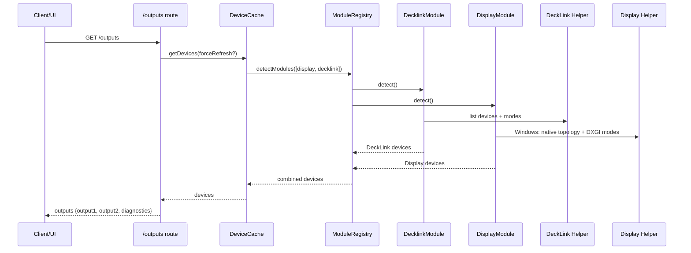

# Bridge Subsystem – Device Discovery

## Zweck
Dieses Subsystem erkennt verfügbare Geräte (DeckLink, Display, USB Capture), cached Ergebnisse und stellt sie der UI als Output‑Liste zur Verfügung.

## Verantwortlichkeiten
- Registrierung von Device‑Modulen
- Parallelisierte Device‑Detection mit Timeout/Isolation
- Cache + Rate‑Limit für Refresh
- Watcher für Hotplug‑Events (DeckLink nativ, Display per Polling)
- Mapping von Device/Port‑Model zu UI‑Outputs

## Hauptkomponenten
- `apps/bridge/src/modules/index.ts`
- `apps/bridge/src/modules/module-registry.ts`
- `apps/bridge/src/modules/polling-device-watch.ts`
- `apps/bridge/src/services/device-cache.ts`
- `apps/bridge/src/modules/decklink/*`
- `apps/bridge/src/modules/display/*`
- `apps/bridge/src/modules/usb-capture/*`
- `apps/bridge/src/routes/outputs.ts`

## Ablauf (Mermaid)

## Cache & Refresh
- Cache TTL: 1s
- Force‑Refresh: rate‑limited (2s)
- Watcher: debounced refresh (250ms)
- Cache wird pro Modul geführt. Timeout/Fehler behalten den letzten erfolgreichen
  Modulstand; ein erfolgreicher leerer Scan entfernt abgezogene Geräte.
- Erfolgreiche Detection/Watch-Refreshes, die den Modul-Fingerprint
  (`id|present|ready|inUse`) aendern, emittieren `onDevicesChanged` mit
  hinzugefuegten und entfernten Output-Port-IDs. Der Graphics-Output-Supervisor
  nutzt diese Events, um eine pending Output-Konfiguration sofort neu
  anzuwenden, wenn der Zielport wieder auftaucht.
- Der DeckLink-`--watch`-Helper wird nach unerwartetem Exit mit Backoff neu
  gestartet (1s bis 30s, maximal 8 Versuche). Unsubscribe bricht geplante
  Restarts ab.
- macOS `system_profiler` hat einen 5s-Kindprozess-Timeout; das Display-Modul erhält
  6s. Spawn-, Exit- und Parsefehler werden als Fehlerstatus an den Cache weitergegeben.
- Windows `display-helper.exe --list-displays` hat einen 2s-Timeout. stderr wird bis
  8 KiB gepuffert; bei Exit ≠ 0 loggt die Bridge strukturiert
  (`event: windows_display_helper_failed` mit `kind`, `exit_code`, `exit_code_hex`,
  `ntstatus`, `stderr_excerpt` ≤ 512 Zeichen, sanitisiertem `helper_path`) und wirft
  einen `WindowsDisplayHelperError` mit `kind`, `exitCode` und `stderrExcerpt`.
- Output-Abfragen erkennen nur `display` und `decklink`. USB-Capture kann dadurch
  weder `/outputs` noch Graphics-Konfiguration blockieren.

## Display-Hotplug per Polling
Weder macOS `system_profiler` noch `display-helper.exe --list-displays` liefern
Push-Events. `DisplayModule.watch()` nutzt deshalb den generischen Poll-Watcher
`apps/bridge/src/modules/polling-device-watch.ts` (`createPollingDeviceWatch`):

- Der Watcher ruft periodisch den regulaeren `DisplayModule.detect()`-Pfad auf;
  `getLastDiagnostics()` spiegelt damit auch den letzten Poll wider.
- Aus dem Ergebnis wird ein stabiler, reihenfolgeunabhaengiger Fingerprint
  gebildet (`fingerprintDisplayDevices`: Device-ID, Name, `present/ready/inUse`,
  Port-ID, Port-Typ, Port-`available`, Modi `WxH@fps`; `lastSeen` ist bewusst
  ausgenommen). Die Registry (`watchAll`) und damit der `DeviceCache` werden nur
  bei geaendertem Fingerprint benachrichtigt.
- Der erste Poll laeuft sofort beim Subscribe und setzt nur die Baseline, ohne
  zu emittieren; ein beim Start bereits angeschlossenes Display loest also
  keinen zusaetzlichen Refresh aus.
- Ein Tick wird uebersprungen, solange ein vorheriger `detect()` noch laeuft.
- Fehler eines Polls werden einmal pro Fehlerserie mit `warn` geloggt
  (`[DisplayModule] Poll failed ...`), weitere Fehler nur mit `debug`; die
  Erholung mit `info`. Der letzte bekannte Fingerprint bleibt erhalten, das
  Polling laeuft weiter.
- Der Timer ist `unref()`ed und haelt den Prozess nicht am Leben. Unsubscribe
  stoppt den Timer; ein danach noch auslaufender `detect()` emittiert nicht.
- Auf nicht unterstuetzten Plattformen (z. B. Linux) startet `watch()` keinen
  Timer.

| Parameter | Wert |
| --- | ---: |
| Standard-Intervall (`DEFAULT_DISPLAY_WATCH_INTERVAL_MS`) | 15s |
| Minimum fuer Override (`MIN_DISPLAY_WATCH_INTERVAL_MS`) | 2000ms |
| Env-Override | `BRIDGE_DISPLAY_WATCH_INTERVAL_MS` |
| Gemessene `system_profiler SPDisplaysDataType -json`-Dauer (Apple Silicon, 2026-10, 5 Laeufe) | 0,40–0,52s |

`BRIDGE_DISPLAY_WATCH_INTERVAL_MS` akzeptiert nur eine dezimale Ganzzahl in
Millisekunden `>= 2000`; andere Werte (z. B. `500`, `abc`, `1e4`) werden mit
einer `warn`-Zeile ignoriert und das Standard-Intervall gilt. Zusammen mit dem
Watch-Debounce des Caches (250ms) und dem Rate-Limit (2s) erscheint ein neu
eingestecktes HDMI-Display (RØDECaster, Projektor) damit im Normalfall nach
hoechstens einem Poll-Intervall in `/outputs`.

## Detection-Budget & Diagnostics
| Bereich | Budget |
| --- | ---: |
| DeckLink-Modul-Timeout | 12s |
| Einzelner DeckLink-Helper-Aufruf | 4s |
| DeckLink-Display-Mode-Cache | 60s |

`/outputs` und `list_outputs` enthalten `diagnostics.platform` und
`diagnostics.decklink.state`. Mögliche DeckLink-Zustände sind `ok`,
`unsupported_platform`, `helper_missing`, `api_unavailable` und `no_devices`.
Ein fehlender oder alter Desktop-Video-Treiber wird über die Helper-Diagnose
sichtbar statt als stille leere Liste zu erscheinen.

Zusätzlich (additiv, optional) liefert `diagnostics.display` den Zustand der
Display-Erkennung (HDMI/DisplayPort). Das Feld fehlt, wenn kein Display-Modul
registriert ist; solange noch keine Erkennung gelaufen ist, wird `ok`/`no_devices`
aus der Anzahl bekannter `display`-Geräte abgeleitet. Das Display-Modul merkt sich
pro `detect()` die letzte Diagnose (`DisplayModule.getLastDiagnostics()`); Fehler
werden weiterhin an die Module-Registry durchgereicht (`detection_failed`), der
Cache behält den letzten gültigen Stand.

| `diagnostics.display.state` | Bedeutung | Zusatzfelder |
| --- | --- | --- |
| `ok` | Helper lief, mindestens ein externes Display gefunden | – |
| `no_devices` | Erkennung erfolgreich, aber kein externes Display | – |
| `unsupported_platform` | Plattform ohne Display-Erkennung (z. B. Linux) | – |
| `helper_missing` | `display-helper.exe` nicht gefunden (`spawn ENOENT`), Installation unvollständig | `message` |
| `missing_runtime` | Windows-Loader bricht vor `main()` ab: `STATUS_DLL_NOT_FOUND` (0xC0000135), `STATUS_ENTRYPOINT_NOT_FOUND` (0xC0000139) oder `STATUS_DLL_INIT_FAILED` (0xC0000142) – in der Praxis fehlende Visual-C++-Runtime (`vc_redist.x64`) | `message`, `exitCode` (unsigned DWORD, z. B. 3221225781) |
| `helper_failed` | Sonstiger Fehler: Exit ≠ 0 mit anderem Code, Timeout, ungültige/zu große Antwort, anderer Spawn-Fehler, macOS `system_profiler`-Fehler | `message`, ggf. `exitCode` |

Die Zuordnung der Helper-Fehlerarten (`WindowsDisplayHelperError.kind`) auf diese
Zustände liegt in `apps/bridge/src/modules/display/display-diagnostics.ts`; die
Exit-Code-Klassifikation (`classifyWindowsHelperExitCode`) in
`windows-display-helper.ts`. Details zu Windows-Loaderfehlern:
`docs/bridge/analysis/windows-display-helper-loader-diagnostics.md`.

## Security & Risiken
- **Native Helper:** DeckLink‑Helper wird per Child‑Process ausgeführt.
- **Platform Abhängigkeit:** DeckLink nur macOS, Display-Module auf macOS/Windows.
- **Untrusted Data:** Helper‑Output wird per Zod geparst und validiert.

## Relevante Dateien
- `apps/bridge/src/services/device-cache.ts`
- `apps/bridge/src/modules/module-registry.ts`
- `apps/bridge/src/modules/polling-device-watch.ts`
- `apps/bridge/src/modules/decklink/decklink-detector.ts`
- `apps/bridge/src/modules/decklink/decklink-helper.ts`
- `apps/bridge/src/modules/display/display-module.ts`
- `apps/bridge/src/modules/display/display-diagnostics.ts`
- `apps/bridge/src/modules/display/display-helper.ts`
- `apps/bridge/src/modules/display/windows-display-helper.ts`
- `apps/bridge/src/services/output-diagnostics.ts`
- `apps/bridge/src/services/outputs-view.ts`
- `apps/bridge/src/modules/usb-capture/usb-capture-detector.ts`
- `apps/bridge/src/routes/outputs.ts`
