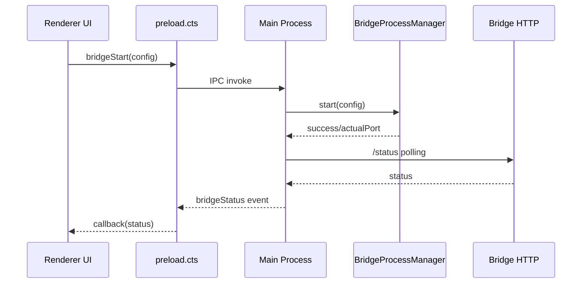

# Desktop Subsystem – Bridge Integration

## Zweck
Beschreibt wie die Desktop‑App die Bridge startet, überwacht und anspricht.

## Ablauf (Mermaid)

## Komponenten
- `src/electron/services/bridge-process-manager.ts`
- `src/electron/services/bridge-health-check.ts`
- `src/electron/services/bridge-outputs.ts`
- `src/electron/services/bridge-profile.ts`
- `src/electron/services/bridge-pairing.ts`

## Hinweise
- Bridge-Start wird nur erlaubt, wenn Terms akzeptiert und Bridge-Name gesetzt sind.
- Der Main‑Process erzeugt einen Pairing‑Code pro Start und gibt ihn per Env‑Var an die Bridge weiter.
- Pairing-Informationen werden in `bridgeStatus` vom Main Process angereichert.
- Relay wird beim Bridge‑Start (GUI) aktiviert und beim Stop deaktiviert.
- Bei Health/Outputs Requests wird `0.0.0.0` intern auf `127.0.0.1` gemappt.
- Die Web-App oeffnet der Main Process erst, wenn das Polling `reachable` **und** `relayConnected` meldet (Fallback nach 15 s), nie direkt aus dem `bridgeStart`-Ergebnis; Details in `main-process.md` („Web-App-Oeffnung").

## Same-Bridge Port Guard (`bridge-process-manager.ts`)
Ist der Wunsch-Port beim Start belegt, fragt der Main Process zuerst `checkBridgeHealth({ host, port })` ab und klassifiziert den Belegenden mit `classifyBusyPortOccupant` (`bridge-process-contract.ts`):

| Belegender | Erkennung | Verhalten |
|---|---|---|
| `same_bridge` | `/status` antwortet JSON **und** `/relay/status.bridgeId` entspricht der eigenen `bridgeId` (`--bridge-id`) | Pollen bis der Port frei ist (`SAME_BRIDGE_PORT_POLL_MS` = 500 ms, max. `SAME_BRIDGE_PORT_RELEASE_TIMEOUT_MS` = 10 s), dann Start auf **demselben** Port. Nie Port+1. Nach Ablauf: Fehler „A Broadify Bridge with this identity is still running on port N; it did not shut down within 10 s". |
| `foreign` | fremde `bridgeId`, keine `bridgeId`, keine JSON-Antwort oder nicht erreichbar | Bisheriger `findAvailablePort(port, port+10)`-Fallback. |

Hintergrund: Die Vorgaenger-Bridge derselben Identitaet (z. B. nach App-Crash, Orphan-Watchdog in `apps/bridge/src/index.ts`) schliesst ihren HTTP-Server als **letzten** Shutdown-Schritt und haelt den Port bis zu ~30 s. Ein Start auf Port+1 in dieser Zeit registrierte eine zweite Bridge mit derselben Identitaet am Relay („zwei Bridges" in der Webapp).

## Fehlerbilder
- Port belegt durch Vorgaenger derselben Bridge → warten (max. 10 s) auf denselben Port, sonst Fehler (nie Port+1)
- Port belegt durch Fremden → autoFallback auf Port+1..+10 oder Fehler
- Bridge nicht erreichbar → Status `reachable=false`
- Terms/Name fehlen → Start wird vor Spawn abgelehnt
- Bridge‑Name fehlt → Start wird abgelehnt

## Relevante Dateien
- `src/electron/main.ts`
- `src/electron/services/bridge-process-manager.ts`
- `src/electron/services/bridge-health-check.ts`
