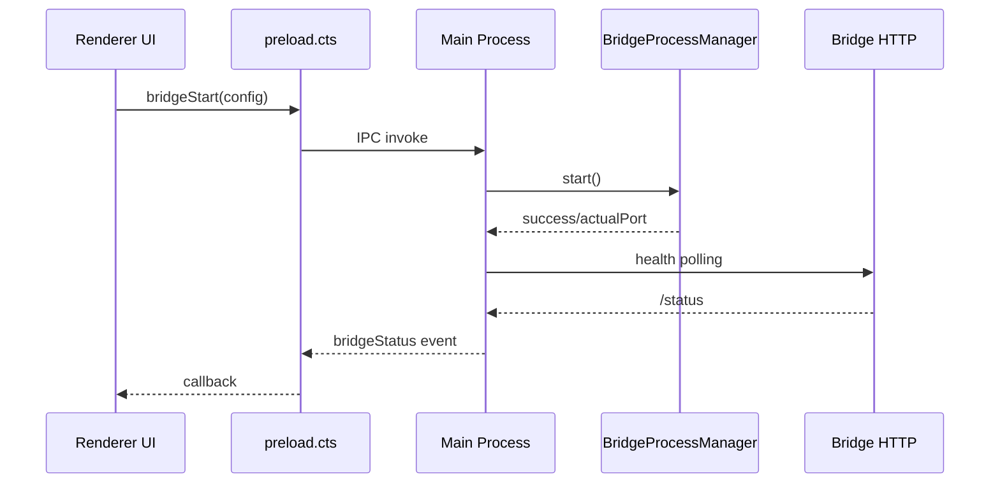

# Desktop Subsystem – Main Process

## Zweck
Der Main‑Process steuert App‑Lifecycle, Fenster, IPC‑Handlers sowie Start/Stop der Bridge. Er orchestriert Health‑Checks, Logs und Updater-Status fuer die UI.

## Verantwortlichkeiten
- Fenster‑Lifecycle (BrowserWindow)
- Single-Instance Lock + Fokus-Handling bei Zweitstart
- Bridge‑Prozess starten/stoppen
- Health‑Check‑Polling und Status‑Broadcast
- IPC‑Handlers für UI‑Actions
- Netzwerk‑Konfiguration laden
- Bridge‑Profil (Name) und Pairing‑Code verwalten
- App-Updater steuern (Check, Download, Install)
- Renderer-Aux-Mode fuer `--graphics-renderer` bootstrappen (Entry-Allowlist, siehe unten)

## Hauptkomponenten
- `src/electron/main.ts`
- `src/electron/main-argv.ts`
- `src/electron/renderer-entry-policy.ts`
- `src/electron/services/bridge-process-manager.ts`
- `src/electron/services/bridge-health-check.ts`
- `src/electron/services/bridge-outputs.ts`
- `src/electron/services/bridge-logs.ts`
- `src/electron/services/app-logs.ts`
- `src/electron/services/app-logger.ts`
- `src/electron/services/port-checker.ts`
- `src/electron/services/network-interface-detector.ts`
- `src/electron/services/bridge-profile.ts`
- `src/electron/services/bridge-pairing.ts`
- `src/electron/services/app-updater.ts`

## Ablauf (Mermaid)

## Env‑Ladereihenfolge (`services/env-loader.ts`)
`loadAppEnv()` lädt `.env`-Dateien mit `override: false` – frühere Dateien gewinnen, spätere füllen fehlende Schlüssel nach.

| Modus | Reihenfolge |
|---|---|
| Dev (`app.isPackaged === false`) | `<cwd>/.env` → `userData/.env` → `resources/bridge/dist/.env`, `resources/bridge/.env` |
| Gepackt (`app.isPackaged === true`) | `userData/.env` → `resources/bridge/dist/.env`, `resources/bridge/.env` |

- Gepackte Builds lesen **nie** aus dem Arbeitsverzeichnis: `cwd` ist für eine installierte App nicht aussagekräftig (`/` auf macOS, Installationsordner bzw. „Ausführen in" einer Verknüpfung auf Windows) und darf keine Konfiguration in ein Release einschleusen.
- Fehlt `userData/.env`, wird sie beim ersten Start aus dem Paket geseedet.
- Release‑gemanagte Schlüssel (`BROADIFY_UPDATER_CHANNEL`, `RELAY_URL`, `BRIDGE_RELAY_JWKS_URL`) werden in beiden Modi abschließend aus dem Paket übernommen und gewinnen über `userData/.env`.
- Nach dem Laden werden die **Schlüsselnamen** aus `userData/.env` (sortiert, nie Werte) nach `app.log` geschrieben: `[Env] userData/.env keys: KEY1, KEY2`.
- `isDev()` (`util.ts`) ist nur wahr, wenn `NODE_ENV=development` **und** `!app.isPackaged`; ein gepackter Build gilt nie als Dev. Gleiches gilt für das `config/network-config.json`-Template in `loadNetworkConfig`: es wird nur im Dev-Modus aus dem `cwd` gelesen.

## Renderer-Aux-Mode (`--graphics-renderer`)
Die Bridge startet fuer Graphics-Renderer und Conference-Display-Fenster dieselbe Desktop-Binary erneut mit `--graphics-renderer --renderer-entry <path>`. `main.ts` erkennt den Aux-Mode **nur** am Flag `--graphics-renderer` (`main-argv.ts`; positionale Pfade zaehlen nicht) und ueberspringt dann Single-Instance-Lock, Fenster und Bridge-Lifecycle.

Vor dem `import()` des Entries prueft `renderer-entry-policy.ts` (`resolveAllowedRendererEntry`):
- regulaere Datei,
- nach `realpath` innerhalb von `process.resourcesPath` oder `app.getAppPath()`,
- Basename in `ALLOWED_RENDERER_ENTRY_BASENAMES` (`electron-renderer-entry.js`, `display-output-entry.js`).

Ablehnung → `console.error("[GraphicsRenderer] Rejected renderer entry (<reason>)")` ohne den untrusted Pfad und `app.exit(1)`. Fehlendes `--renderer-entry` → Exit 1 wie bisher. Details zum Contract: `docs/bridge/subsystems/renderer-ipc.md`.

## Security‑Hinweise
- IPC‑Handler sind die einzige Brücke vom Renderer.
- `--renderer-entry` wird gegen Allowlist (Root + Basename, symlink-aufgeloest) geprueft; fremde Skripte koennen nicht in den signierten Main-Prozess geladen werden.
- IPC Sender Frames werden via `validateEventFrame` verifiziert.
- Bridge‑API wird lokal via HTTP angesprochen.
- BrowserWindow setzt Preload explizit; Security-defaults bleiben aktiv, da Flags nicht gelockert werden.
- Pairing‑Code wird nicht über CLI‑Args, sondern via Env‑Vars an die Bridge übergeben.
- Relay wird beim Bridge‑Start (GUI) aktiviert und beim Stop deaktiviert.
- Bridge-Start wird im Main Process durch Terms-Akzeptanz + Bridge-Name gate-kept.

## Relevante Dateien
- `src/electron/main.ts`
- `src/electron/services/bridge-process-manager.ts`
- `src/electron/services/bridge-health-check.ts`
